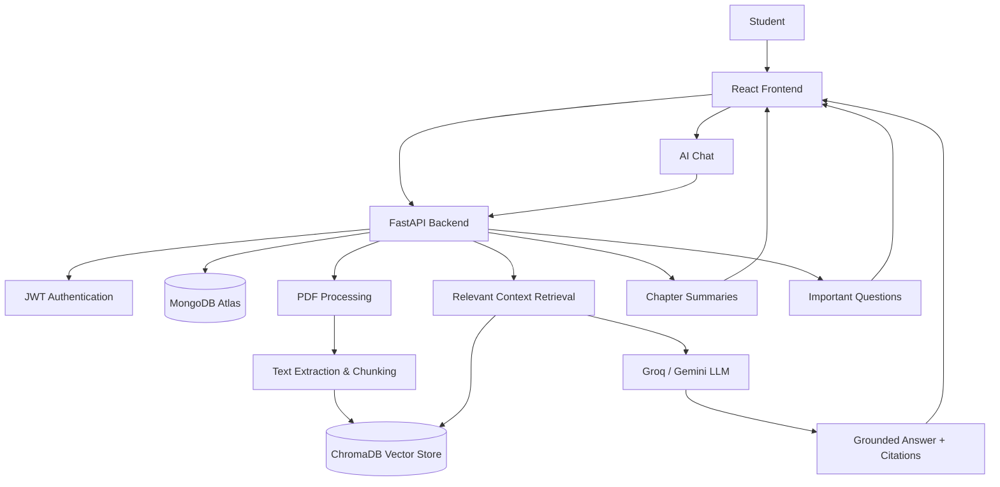

# CourseMate AI

An AI-powered study assistant that helps students learn from their own study materials using Retrieval-Augmented Generation (RAG).

## Features

- Secure user authentication using JWT.
- Create and manage courses.
- Upload and process PDF documents.
- AI-powered question answering using RAG.
- Source citations with document names and page numbers.
- Generate chapter summaries.
- Generate important exam-oriented questions.

## Tech Stack

**Frontend**
- React
- Vite
- React Router
- Axios
- Lucide React

**Backend**
- Python
- FastAPI
- MongoDB
- ChromaDB
- JWT Authentication
- Groq / Gemini LLM providers

## How It Works

1. Create an account and log in.
2. Create a course.
3. Upload PDF study materials.
4. Documents are processed and stored for retrieval.
5. Ask questions based on uploaded materials.
6. Receive AI-generated answers with source citations.
7. Generate chapter summaries and important questions.

## Project Structure

- `backend/` - FastAPI backend and RAG pipeline.
- `frontend/` - React application.
- `backend/tests/` - Backend test suites.

## Setup

### Backend

```bash
cd backend
python3 -m venv venv
source venv/bin/activate
pip install -r requirements.txt
cp .env.example .env

Configure the environment variables in backend/.env.

Run:
python -m uvicorn app.main:app --reload

Frontend
Open another terminal:
cd frontend
npm install

Create frontend/.env:
VITE_API_URL=http://localhost:8000

Run:
npm run dev

API Documentation
Once the backend is running:

http://localhost:8000/docs
Project Status
Core backend and frontend integration completed.
Built with React, FastAPI, MongoDB, ChromaDB and LLM-powered RAG.

## System Architecture


